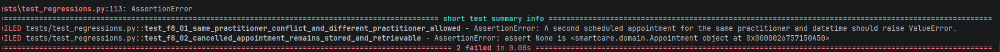
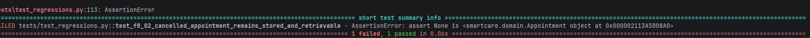
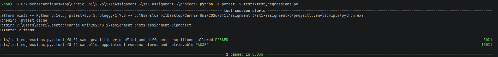
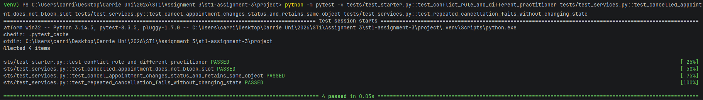
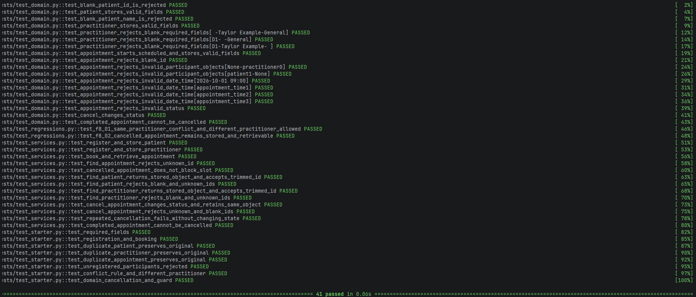
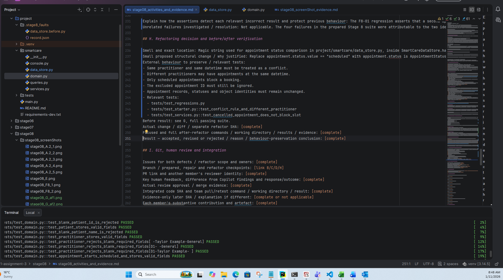
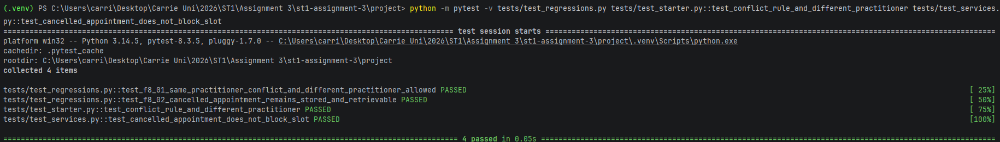
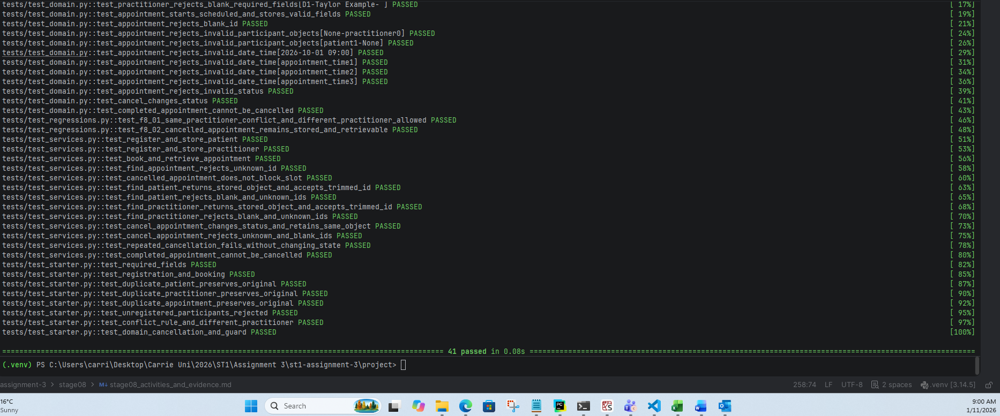

# Stage 8 – Debugging Screenshots

## 1. A.2 Build a debugging record

## 2. C. F8-01 and D. F8-02 diagnosis and repair

## 3. E. Human-first hypotheses

## 4. G. Failing to passing regression evidence - before repair

## 5. G. Failing to passing regression evidence - after repair

## 6. H. Refactoring decision and before verification

## 7. H. Refactoring decision and after verification

