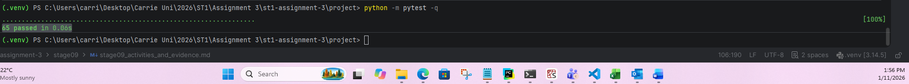
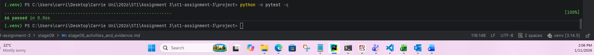

# Stage 9 activities and evidence

Common UG and PG record. All Assignment 3 stage materials are provided from the beginning. Complete this stage only after the previous applicable stage has been integrated, verified and recorded. Use this supplied record in stage09/ in your EXISTING repository. Preserve project/, all earlier tests, records and responses. Do not download another starter or copy staff solutions. Use the Stage 9 handout and Overview/revision 2 baseline. Keep responses concise and link accessible artefacts; do not paste entire logs or private peer ratings.

Group: Group Exception 1
Members and responsibilities: Carrie Sullivan - completion of all activities except independent review
Stage 8 integrated SHA, command, working directory and actual result:
- Integrated Stage 8 SHA: ae08d6bfaeb5d5eafd00e5cba084dd4f8e59fd2c
- Test command: python -m pytest -q
- Working directory: project/
- Actual result: 41 passed in 0.07s

## A. Tutorial activities

### A1 Session state classification

| Information            | Required session/domain or transient state? | Requirement or reason                                                                |
|------------------------|---------------------------------------------|--------------------------------------------------------------------------------------|
| Patient identity       | Required session/domain state               | Needed to identify registered patients and link appointments to the correct patient. |
| Appointment history    | Required session/domain state               | Must remain available during the session, including cancelled appointments.          |
| Temporary menu choice  | Transient interaction state                 | Only needed to determine the current menu operation.                                 |
| Practitioner specialty | Required session/domain state               | Part of the practitioner's registered information.                                   |
| Debug print output     | Transient interaction/debug state           | Diagnostic output is not part of the application's stored domain data.               |
| Appointment status     | Required session/domain state               | Records whether an appointment is scheduled, cancelled or completed.                 |

What is intentionally lost on exit? All in-memory session data is intentionally lost when the program exits. This includes registered patients, practitioners, appointments and appointment history. The application does not provide persistent storage in Stage 9.

### A2 Interface and domain data plan

Plan before AI. This replaces schema/key design; no database tables are required.

| Function or component | Explicit inputs and types                                                                       | Outputs                            | Responsibility and validation                                                                                                                                            | Domain source / existing constraint                                                                                                                                                                                                                                 |
|-----------------------|-------------------------------------------------------------------------------------------------|------------------------------------|--------------------------------------------------------------------------------------------------------------------------------------------------------------------------|---------------------------------------------------------------------------------------------------------------------------------------------------------------------------------------------------------------------------------------------------------------------|
| appointment_sort_key  | appointment: Appointment                                                                        | tuple[datetime, str]               | Return (date_time, appointment_id) for deterministic ascending sorting.                                                                                                  | Uses read-only Appointment.date_time and Appointment.appointment_id properties.                                                                                                                                                                                     |
| select_appointments   | appointments: list[Appointment], practitioner_id: str, status: AppointmentStatus \| None = None | list[Appointment]                  | Filter by practitioner ID and, if supplied, status. Return a new list sorted by the named key. Do not mutate the source list or appointment objects.                     | Uses appointment.practitioner.practitioner_id, appointment.status, and the three AppointmentStatus values. It does not validate practitioner registration.                                                                                                          |
| Service listing       | practitioner_id: str, status: AppointmentStatus \| None = None                                  | list[Appointment]                  | Validate the practitioner and supplied status; obtain a fresh list from data_store.list_appointments() and pass it to select_appointments.                               | Uses find_practitioner(), to trim and reject blank IDs, and list_appointments(), to return a new list containing the stored appointment objects.                                                                                                                    |
| Console               | User-entered menu choices and values as str                                                     | Displays results and messages only | Prompt, parse, call services, display results and recover from expected ValueError and LookupError. Convert status text to AppointmentStatus before calling the service. | Uses the existing Patient, Practitioner and Appointment constructors and service operations. Patient and practitioner IDs/names and specialty are validated; appointments require actual participant objects, a valid status and a minute-precision local datetime. |

Relate patient ID/name, practitioner ID/name/specialty, and appointment ID/actual participants/date_time/status to the existing contracts: Patient stores a validated patient_id and name; patient_id is read-only. Practitioner stores a validated, read-only practitioner_id, name and specialty. Appointment stores a validated, read-only appointment_id, references to the actual registered Patient and Practitioner objects, a validated date_time, and an AppointmentStatus (SCHEDULED, CANCELLED or COMPLETED). The data store checks that appointment participants are the exact registered objects, not just objects with matching IDs. Its lookup methods use IDs, and its listing methods return new lists containing the stored objects.

### A3 Responsibility violations

| Conceptual case                 | Violation                                                                                                                     | Correct boundary and reason                                                                                                                                                                   |
|---------------------------------|-------------------------------------------------------------------------------------------------------------------------------|-----------------------------------------------------------------------------------------------------------------------------------------------------------------------------------------------|
| Appointment.cancel reads input  | The domain object handles console interaction, mixing business rules with user-interface code.                                | The console should ask for confirmation. The service should coordinate the cancellation, and Appointment.cancel() should enforce the rule that only a scheduled appointment can be cancelled. |
| Service prints/reads the menu   | The service handles user interaction instead of focusing on application operations.                                           | The console should display the menu, read the user's choice and call the appropriate service method. The service should coordinate the requested operation without printing or prompting.     |
| Query sorts its source in place | The query changes the caller's list, creating an unintended side effect and potentially affecting other code using that list. | The query should return a new sorted list, for example using sorted(), and leave the original list unchanged.                                                                                 |
| Store prints Appointment saved  | The data store mixes data management with presentation by displaying a user-facing message.                                   | The store should manage and retrieve stored objects. The console should display the success message after the service completes the operation.                                                |

### A4 Sorting comparison

For `appointments.sort(key=appointment_sort_key)` and `result = sorted(appointments, key=appointment_sort_key)`, predict source order, return value and result identity. Give a meaningful mutation check:
| Expression | Source list after operation | Return value | Result identity |
|---|---|---|---|
| appointments.sort(key=appointment_sort_key) | The original list is reordered in place. | None | No separate result list is created; appointments is the same list object. |
|result = sorted(appointments, key=appointment_sort_key) | The original list remains in its existing order. | A new sorted list. | result is appointments is False, but the elements in both lists can be references to the same Appointment objects. |

Meaningful mutation check:
Make a copy of the original list order before running the query, then check that the original list still has the same objects in the same order. Also compare relevant appointment fields before and after to check objects themselves were not changed.

Score-example prediction and explanation of passing the named key:
- Example: [("Chen", 5), ("Ali", 8), ("Bea", 8)]
- Explanation: The records are ordered by score first, then alphabetically by name when scores are equal. Passing key=appointment_sort_key gives the sorting function the key function to call for each item. It is different from calling the function yourself inside the argument: key=appointment_sort_key().

### A5 Exit question

Explain cancellation versus deletion, and checks for same-session lookup, all-status listing and SCHEDULED-only exclusion:
Cancellation and deletion are different operations. Cancellation changes the status of an existing appointment from SCHEDULED to CANCELLED. The appointment remains stored, so its history can still be accessed. Deletion removes the appointment record, which would lose the history.

The checks should confirm that:
- Same-session lookup: After cancelling an appointment, searching for its ID still returns the same appointment object, with status CANCELLED.
- All-status listing: Listing appointments for the practitioner without a status filter includes the cancelled appointment as well as scheduled and completed appointments.
- SCHEDULED-only exclusion: Listing with AppointmentStatus.SCHEDULED excludes the cancelled appointment, while leaving it available through lookup and an unfiltered listing.

## B. Human design and contracts

Complete before GitHub Copilot. Record any interface/integrity decision and its reasoning: Retain the existing domain and data-store interfaces and build the Stage 9 functionality around them. Query functions will receive data explicitly and will not access the data store, prompt users or modify appointment records. Services will coordinate operations and validate requests, while the console will handle user input, display and recovery from expected errors. Appointment cancellation will update the existing appointment's status rather than delete the record. Existing domain validation and registered-object identity checks will remain in place.

| Requirement                       | Input / session data                                                     | Operation and responsible component                                                                            | Expected result or error                                                                                                   | Test / evidence                                                                        |
|-----------------------------------|--------------------------------------------------------------------------|----------------------------------------------------------------------------------------------------------------|----------------------------------------------------------------------------------------------------------------------------|----------------------------------------------------------------------------------------|
| QRY-01: Practitioner filtering    | Appointment list and practitioner ID                                     | select_appointments() filters by practitioner ID.                                                              | Only appointments belonging to the requested practitioner are returned.                                                    | Test two practitioners and confirm their appointments are kept separate.               |
| QRY-02: Status filtering          | Appointment list and optional AppointmentStatus                          | Query filters by status when supplied; None includes all statuses.                                             | Correct status results or an empty list when there are no matches.                                                         | Test all three statuses and the default unfiltered result.                             |
| QRY-03: Deterministic sorting     | Matching appointments                                                    | appointment_sort_key() supplies date/time and appointment ID as the sorting key; query returns sorted results. | Ascending date/time order, with appointment ID breaking ties.                                                              | Test different dates and equal date/time values; confirm source order is unchanged.    |
| QRY-04: Service validation        | Practitioner ID and optional status                                      | Appointment service checks the practitioner and status before calling the query.                               | Unknown practitioner raises LookupError; invalid ID or status raises ValueError.                                           | Test known, unknown and invalid inputs separately.                                     |
| FP-01: Explicit inputs and purity | Appointment list, practitioner ID and optional status                    | Query uses only its arguments and returns a result without accessing global state or performing I/O.           | Same inputs produce the same result without changing application state.                                                    | Repeat calls and inspect the query implementation for hidden state, printing or input. |
| FP-02: No source mutation         | Original appointment list and its objects                                | Query creates and returns a new sorted list.                                                                   | Original list order and appointment fields remain unchanged.                                                               | Compare original list order and relevant fields before and after the query.            |
| FP-03: Named sorting key          | Appointment object                                                       | appointment_sort_key() returns (date_time, appointment_id) and is passed to sorting.                           | Consistent and reusable sorting behaviour.                                                                                 | Test the key directly and confirm the query uses it.                                   |
| UI-01: Normal menu workflow       | Patients, practitioners and appointments in one session                  | Console calls registration, booking, finding, cancellation and listing services.                               | Menu continues operating; cancellation remains visible in history and frees the scheduled slot.                            | Record a successful menu demonstration and its output.                                 |
| UI-02: Invalid menu inputs        | Unknown choices, IDs, duplicate records, invalid dates and statuses      | Console handles expected errors and returns to the menu.                                                       | Clear error messages; application continues without unintended state changes.                                              | Record invalid-input demonstrations followed by successful operations.                 |
| FR-01–09: Functional requirements | User-entered IDs, names, specialty, appointment details and menu choices | Console dispatches each supported operation to the appropriate service and displays the result.                | Registration, lookup, booking, cancellation and practitioner appointment listing work according to the existing contracts. | Use the relevant service and workflow tests, plus console evidence.                    |

Cover QRY-01–04, FP-01–03, UI-01–02 and relevant FR-01–09. Explain:
- empty versus unknown versus invalid:
  - Empty result: A known practitioner with no appointments, or no appointments matching a valid filter, should receive an empty list. This is a valid result, not an error.
  - Unknown practitioner: A correctly formatted practitioner ID that does not identify a registered practitioner should raise LookupError.
  - Invalid input: A blank or malformed ID, or a status that is not a valid AppointmentStatus, should raise ValueError.
- enum conversion: The console receives status as text. It should convert valid text to an AppointmentStatus value before calling the service. The service should accept an enum value or None, not interpret arbitrary strings as valid statuses. A blank status in the listing menu means no filter (None), so all statuses are included.
- actual object identity: When booking an appointment, the appointment must reference the actual registered Patient and Practitioner objects returned by the data store. The data store checks object identity when adding an appointment, protecting the relationships between stored records.
- error handling and unchanged state on rejection: Expected ValueError and LookupError exceptions should be handled by the console with understandable messages, allowing the user to return to the menu. The application should not silently ignore errors or use a broad exception handler to hide unexpected defects.
If a registration or booking is rejected because of an invalid ID, duplicate ID, unknown participant or practitioner conflict, the existing records must remain unchanged. A rejected booking must not reserve its appointment ID or leave a partial appointment in the store.

## C. Implementation and query verification

| Requirement / test ID | Code location                                    | Case and meaningful assertion                                                                             | Actual result                     | Evidence link                                                         |
|-----------------------|--------------------------------------------------|-----------------------------------------------------------------------------------------------------------|-----------------------------------|-----------------------------------------------------------------------|
| QRY-01                | smartcare/queries.py / tests/test_queries.py     | Appointments from two practitioners are separated correctly.                                              | Passed                            |          |
| QRY-02                | smartcare/queries.py / tests/test_queries.py     | Test SCHEDULED, CANCELLED, COMPLETED and None (all statuses).                                             | Passed for all four filter cases. |          |
| QRY-02                | tests/test_queries.py                            | No matching appointments returns an empty list.                                                           | Passed                            |          |
| QRY-03                | smartcare/queries.py / tests/test_queries.py     | Appointments are sorted by date/time, then appointment ID for equal times.                                | Passed                            |          |
| FP-01                 | smartcare/queries.py / tests/test_queries.py     | Repeated calls with identical inputs return consistent results.                                           | Passed                            |          |
| FP-02                 | smartcare/queries.py / tests/test_queries.py     | Empty, already-sorted and unsorted inputs return fresh lists.                                             | Passed                            |  |
| FP-02                 | test/test_queries.py                             | Original list order and appointment fields remain unchanged.                                              | Passed                            |          |
| FP-03                 | smartcare/queries.py / tests/test_queries.py     | Test appointment_sort_key() directly and confirm the query uses it.                                       | Passed                            |          |
| QRY-04                | smartcare/queries.py / tests/test_queries.py     | Known practitioner with no appointments returns an empty list.                                            | Passed                            |          |
| QRY-04                | smartcare/queries.py / tests/test_queries.py     | Unknown practitioner raises LookupError.                                                                  | Passed                            |          |
| QRY-04                | smartcare/queries.py / tests/test_queries.py     | Blank practitioner ID and invalid status raise ValueError.                                                | Passed                            |          |
| History               | tests/test_services.py / tests/test_workflows.py | Cancelled appointment remains findable and appears in all-status listing, but not scheduled-only listing. | Passed                            |          |
One small post improvement made to FR-02 after initial implementation. Additional check is for empty-list freshness. Result was 66 passed in 0.06s.

Include practitioner isolation, every enum status/default all, equal-time ID tie-break, named-key reuse, repeated calls, empty/already-sorted fresh lists, unchanged source order/fields, known-empty/unknown/invalid service cases and retained history.

Purity explanation from code inspection, including absence of hidden state and I/O: The appointment query functions receive all required information through explicit parameters, including the appointment collection, practitioner ID and optional status. They do not access global variables, the data store or hidden application state. They do not prompt for input, print output or perform file or database operations. The appointment_sort_key() function returns a tuple containing the appointment date/time and appointment ID, providing a consistent tie-break when appointments have the same time. The select_appointments() function uses this named key with sorted() to return a new list rather than modifying the supplied list. It filters appointments by practitioner and, when a status is supplied, by the requested AppointmentStatus. A None status includes all statuses. The functions only read appointment properties and do not modify the original list or appointment objects. Repeated calls with the same inputs therefore produce consistent results.
What the tests do and do not establish: The tests establish that appointments are correctly separated by practitioner and filtered using each of the three appointment statuses, with None returning all statuses. They verify that appointments are ordered by date/time and that appointment ID is used to break equal-time ties. They also test appointment_sort_key() directly and confirm that the query reuses the named function. Repeated-call tests establish consistent results for identical inputs. Empty, already-sorted and unsorted input tests verify that new lists are returned, while source-list and appointment-field checks verify that the original data remains unchanged.
The service tests establish that a known practitioner with no matching appointments receives an empty list, an unknown practitioner raises LookupError, and blank practitioner IDs or invalid status values raise ValueError. The history and workflow tests establish that cancellation changes the appointment status without deleting the record: the cancelled appointment remains findable and appears in an all-status listing, but is excluded from a scheduled-only listing.
The tests provide evidence for the specific cases covered, but do not prove that the application is free from every possible defect. Code inspection is also needed to identify hidden dependencies, input/output operations and unintended side effects. Separate console testing is needed to establish that the interactive menu handles actual user input and recovers from expected errors.

## D. Integrated console and workflow evidence

| Scenario / acceptance ID     | Reproducible inputs / artefact                                                                                                                                                                                                                                                                                                                                                                         | Expected result                                                                                                                                                                                                                                                                                         | Observed result and state check                                                                                                                                                                                                                                                                                                                                                                                                                                                                                                                                                                           | Evidence link                                                            |
|------------------------------|--------------------------------------------------------------------------------------------------------------------------------------------------------------------------------------------------------------------------------------------------------------------------------------------------------------------------------------------------------------------------------------------------------|---------------------------------------------------------------------------------------------------------------------------------------------------------------------------------------------------------------------------------------------------------------------------------------------------------|-----------------------------------------------------------------------------------------------------------------------------------------------------------------------------------------------------------------------------------------------------------------------------------------------------------------------------------------------------------------------------------------------------------------------------------------------------------------------------------------------------------------------------------------------------------------------------------------------------------|--------------------------------------------------------------------------|
| UI-01 full menu workflow     | Interactive console session. Register patient P1 and practitioners D1 and D2. Find each registered record. Book A1 for P1 with D1 at 2026-10-01 09:00. Attempt another booking with D1 at the same time. Book A2 with D2 at the same time. Cancel A1, find A1, list D1 appointments with all statuses and then SCHEDULED only. Book A3 with D1 at the freed time. List D1 appointments again and exit. | Registration and retrieval succeed. The same-practitioner conflict is rejected. D2 can accept an appointment at the same time. A1 remains findable with CANCELLED status. All-status listing includes A1; scheduled-only listing excludes it. A3 can use the freed D1 time slot. Exit ends the session. | The interactive menu successfully completed the full workflow. Patient P1 and practitioners D1 and D2 were registered and retrieved. Appointment A1 was booked for D1. A second booking for D1 at the same time was rejected with a practitioner conflict error, while A2 for D2 at that time was accepted. A1 was cancelled and remained retrievable with status CANCELLED. Listing all statuses showed A1, while the scheduled-only listing returned no matching appointments. A3 was then successfully booked for D1 at the released time slot. The menu remained operational throughout the workflow. | [stage09_activities_and_evidence.md](stage09_activities_and_evidence.md) |
| UI-02 invalid-input recovery | Interactive console session. Try an unknown menu choice, blank and unknown IDs, duplicate registration, booking with unknown patient or practitioner, malformed and impossible dates, invalid listing status, unknown appointment and repeated cancellation. After each rejection, perform a valid operation.                                                                                          | Each invalid request produces a meaningful error without crashing or partially changing stored records. The menu remains available. A subsequent valid operation succeeds. Repeated cancellation is rejected without changing the already-cancelled appointment.                                        | The interactive menu handled invalid inputs without crashing. An unknown menu choice, blank patient ID, duplicate patient ID, unknown patient during booking, malformed date, impossible calendar date, invalid appointment status and unknown appointment lookup each produced an appropriate error message and returned control to the menu. A repeated cancellation of A1 was rejected because only scheduled appointments may be cancelled. The checks confirmed that expected input and lookup errors were handled at the console boundary.	                                                          | [stage09_activities_and_evidence.md](stage09_activities_and_evidence.md) |
| Automated service workflow   | project/tests/test_workflows.py; run python -m pytest -q from project/.                                                                                                                                                                                                                                                                                                                                | Booking, cancellation, retained history, scheduled-only filtering, freed-slot reuse, practitioner conflict rejection, different-practitioner bookings and rejection of unknown-patient booking are verified. Rejected bookings leave appointment records unchanged.                                     | Passed. Six workflow tests passed as part of the full suite: 66 passed in 0.06s.                                                                                                                                                                                                                                                                                                                                                                                                                                                                                                                          |     |

Include registration/find, booking, conflict rejection, different-practitioner booking, cancellation, retrieval, listing/filtering, freed slot and exit; duplicate/unknown/blank IDs, malformed/impossible date, invalid status, unknown choice and repeated cancellation. Identify before/after state and subsequent successful action.

## E. GitHub Copilot review and human decisions

Human design completed before AI: commit - c31e2af, PR link - https://github.com/carrie-mack-sulli/st1-assignment-3/pull/11
Actual prompt/context supplied:
Act as a query and console integration reviewer for SmartCare.
Review the supplied code and tests for:
1. explicit inputs, purity and source non-mutation;
2. domain, service, data-store and console responsibilities;
3. validation and recovery without partial state changes;
4. correct object identity, enum filtering and ordering;
5. retained history and integrity risks;
6. missing query, workflow and console tests.
Do not redesign the domain or add storage/frameworks.
Do not invent fields or requirements or delete cancelled history.
Separate observed evidence from optional improvements.
Rank findings as Critical, Important or Optional.
For each finding, identify the code/test evidence to check.

Actual response: [stage09_gitHub_copilot_review.md](stage09_gitHub_copilot_review.md)
Human design completed before AI: Refer to section B
Actual prompt/context supplied: Refer section E
Actual response: [stage09_gitHub_copilot_review.md](stage09_gitHub_copilot_review.md)

| AI finding                                                                | Code/test evidence                                                                                                                      | Severity  | Accept/Modify/Reject and reason                                                                                                                                                                                               | Change or no change                                                                                                 | Actual verification                                                                                                                                             |
|---------------------------------------------------------------------------|-----------------------------------------------------------------------------------------------------------------------------------------|-----------|-------------------------------------------------------------------------------------------------------------------------------------------------------------------------------------------------------------------------------|---------------------------------------------------------------------------------------------------------------------|-----------------------------------------------------------------------------------------------------------------------------------------------------------------|
| Duplicate run_menu() definitions in console.py                            | Two definitions were found in project/smartcare/console.py.                                                                             | Critical  | Accept. Copilot correctly identified an accidental duplicate caused by adding the updated run_menu code twice.                                                                                                                | Removed the obsolete definition                                                                                     | Confirmed only one run_menu() remains. Full suite: 66 passed in 0.07s. Interactive menu manually tested and working.                                            |
| Status parsing bug in the first run_menu() definition                     | The obsolete definition contained status-parsing logic that attempted enum conversion after blank input.                                | Critical  | Accept as part of the duplicate correction.                                                                                                                                                                                   | Removed with the obsolete duplicate                                                                                 | Blank status was successfully tested in UI-01; interactive menu remains functional.                                                                             |
| Missing automated console workflow tests                                  | project/tests/test_workflows.py covers service workflows. UI-01 and UI-02 were also manually exercised and documented with screenshots. | Important | Modify – partly valid. Console behaviour was manually tested, so it is inaccurate to say the entire workflow is untested. However, there are no dedicated automated tests simulating menu input and asserting console output. | No change for this stage unless automated console tests are specifically required. Manual evidence is retained.     | UI-01 and UI-02 were manually completed. The full automated suite passed 66 tests.                                                                              |
| Query purity and non-mutation not explicitly tested                       | project/tests/test_queries.py checks repeated calls, a new returned list, source-list preservation and unchanged appointment data.      | Important | Reject. These tests already cover the stated concern.                                                                                                                                                                         | No change required.                                                                                                 | Full suite: 66 passed. Query tests include source-order and field preservation, repeated calls and fresh-list checks.                                           |
| Ordering by (date_time, appointment_id) not tested                        | appointment_sort_key() and select_appointments() in project/smartcare/queries.py; ordering tests in project/tests/test_queries.py.      | Important | Reject. The tests include appointments with matching date/time values and verify the appointment-ID tie-break.                                                                                                                | No change required.                                                                                                 | Full suite: 66 passed. The query ordering tests passed.                                                                                                         |
| Enum filtering correctness not tested                                     | select_appointments() in queries.py; parameterised status and practitioner-filter tests in project/tests/test_queries.py.               | Important | Reject. Tests cover the individual appointment statuses, the None all-status case, and practitioner filtering.                                                                                                                | No change required.                                                                                                 | Full suite: 66 passed. Status and practitioner-filter tests passed.                                                                                             |
| Inline AppointmentStatus import inside the second run_menu()              | Copilot identified an import inside the status-selection branch.                                                                        | Important | Modify – optional cleanup only. If the module-level import already exists, the local import is redundant. It is a consistency issue rather than a demonstrated functional defect.                                             | No functional change required. Remove the redundant local import only if confirmed in the retained menu definition. | The menu's status selection was manually exercised, including blank status and invalid status input.                                                            |
| Console error messages do not distinguish input errors from domain errors | console.py catches expected ValueError and LookupError exceptions and displays their messages.                                          | Optional  | Reject for this stage. The current messages communicate the actual validation or lookup error, and the menu recovers without terminating. More elaborate error categorisation is not required for the stated scope.           | No change.                                                                                                          | UI-02 manually verified blank IDs, duplicate registration, unknown participants, invalid dates, invalid status, unknown appointments and repeated cancellation. |
| No tests for the no-matching-appointments branch                          | The empty-results branch in console.py; UI-01 scheduled-only listing for D1 after A1 was cancelled.                                     | Optional  | Modify – partly valid. The behaviour was manually verified, but there is no dedicated automated console assertion for the displayed message.                                                                                  | No change required for the current scope; retain the manual evidence.                                               | UI-01 displayed No matching appointments found. for the scheduled-only listing after cancellation.                                                              |
| Query docstring could mention retained history more explicitly            | select_appointments() in project/smartcare/queries.py; tests covering status=None and cancelled/completed appointments.                 | Optional  | Accept as a documentation improvement, if useful. Explicitly stating that status=None includes all statuses would make the contract clearer.                                                                                  | Optional docstring clarification; no functional change.                                                             | Existing query tests verify that the None filter includes appointments across statuses, including cancelled and completed records.                              |

Responsibility check: explain how domain invariants, shared-store collections, service coordination, pure queries and console effects remain separate: The responsibilities remain separated across the application layers. The domain classes (Patient, Practitioner and Appointment) hold the data and enforce their own invariants, including valid identifiers, valid appointment status, valid date/time and guarded cancellation. The SmartCareDataStore manages the shared in-memory patient, practitioner and appointment collections, checks that appointments reference the actual registered patient and practitioner objects, and retains cancelled appointment records.
The service classes coordinate operations between the domain objects and the shared data store. They perform lookups, validate requests, enforce booking rules and coordinate appointment listing and cancellation. The query functions are separate pure collection-processing functions: they receive their inputs explicitly, filter and sort appointments, return a new list, and do not prompt for input, print output, access the data store or mutate appointment records. The console is responsible for user interaction: displaying the menu, reading and parsing input, converting status text to an enum, calling services, displaying results and recovering from expected errors.
This separation means that domain rules remain in the domain, shared records remain managed by the data store, application operations are coordinated by services, reusable filtering and sorting remain in pure queries, and input/output effects remain in the console.
Responsibility check: explain how domain invariants, shared-store collections, service coordination, pure queries and console effects remain separate: <!-- response -->

## F. Required reflections

1. Which integration concern was architectural rather than a filtering/sorting detail? The separation of responsibilities between the domain, data store, services, queries and console was an architectural concern. The query functions needed to remain pure and handle only filtering and sorting, while the services coordinated operations and validation using the shared data store. The console was responsible for user input, output and recovery from expected errors. Keeping these responsibilities separate helped prevent business rules and data-management responsibilities from being duplicated in the console or query layer.
2. Which Copilot suggestion did you reject as over-engineering, and why? I rejected the suggestion to make console error messages distinguish input errors from domain errors as an unnecessary enhancement. The existing handling of ValueError and LookupError displayed useful error messages and returned control to the menu without terminating the session. Introducing additional error categories would add complexity without being necessary at this stage.
3. How did you prove cancelled appointments remain retrievable and listable in the same session? I tested this through both the automated workflow tests and the interactive console. I booked appointment A1, cancelled it, and then retrieved it using the appointment lookup option. It remained available with its status shown as CANCELLED. I then listed all appointments for the practitioner and confirmed that A1 was included. When I filtered the same practitioner's appointments by SCHEDULED, A1 was excluded. This demonstrated that cancellation updates the appointment's status rather than deleting the record, and that its history remains accessible during the session.

## G. Ten formative answers

1. What makes select_appointments pure, and what side effect breaks purity? select_appointments() is pure because it uses explicit inputs, returns a new sorted list and does not change the original data. Modifying the source list in place, printing output or changing appointment records would break its purity.
2. Which explicit inputs are needed, and why avoid a global store? The explicit inputs are the appointment list, practitioner ID and optional appointment status. Avoiding a global store makes the query independent, predictable and reusable, without hidden dependencies or unintended changes to shared data.
3. How can a new list reuse Appointment objects safely? A new list can safely reuse the original Appointment objects because the query only reads them and does not modify it. This preserves object identity while allowing the returned list to be sorted independently without changing the source list.
4. Why use a named key, and what breaks equal-time ties? A named key makes the sorting rule reusable, clear and consistent. Equal appointment times are broken by sorting on appointment_id as the second part of the key, ensuring deterministic ordering.
5. How do default and explicit status filters differ? With the default filter (status=None), all appointments are returned, including scheduled, cancelled and completed. An explicit status filter returns only appointments matching the selected status.
6. How do empty, unknown practitioner and invalid filter cases differ? An empty result means the practitioner exists but has no matching appointments, so an empty list is returned. An unknown practitioner raises LookupError, while an invalid practitioner ID or status filter raises ValueError.
7. Which console errors recover, and how is unchanged state checked? The console recovers from expected ValueError and LookupError exceptions, including blank or invalid IDs, duplicate registrations, unknown participants, malformed dates, invalid statuses and repeated cancellations. Unchanged state is checked by comparing stored records before and after a rejected operation to confirm no records were added, removed or modified.
8. What is data integrity for registered participants, conflicts and history? Data integrity means ensuring appointments use the actual registered Patient and Practitioner objects, preventing double-booking with the same practitioner at the same time, and retaining cancelled appointments in history rather than deleting them.
9. What is Copilot's review role, and who verifies findings? Copilot acts as an AI reviewer that identifies possible defects, missing tests and improvement suggestions. The developer must critically assess each finding, verify it against the actual code and test results, and decide whether to accept, modify or reject it.
10. How do pure functions and OOP responsibilities work together? Pure functions handle predictable tasks such as filtering and sorting without changing shared data. OOP classes manage domain rules and state, while services coordinate operations and the console handles user interaction. Together, they keep responsibilities separate and the application easier to test and maintain.

## H. Review, completion and common handover

Issues and bounded branches: feature/stage9-queries
PR/diff and another-member human reviewer: (https://github.com/carrie-mack-sulli/st1-assignment-3/pull/11) - N/A - approved individual completion arrangement; this activity requires another group member.
Review responses and Copilot comparison: Please refer to section E and [stage09_gitHub_copilot_review.md](stage09_gitHub_copilot_review.md)
Integrated common Stage 9 SHA: 	233a1fc1237fd244e4a39a32151851ceda46057e
Full regression command, working directory, actual count/result and evidence: python -m pytest -q
README run instructions and scope/limitations: [README.md](../project/README.md)
Unresolved issues and support/action: No known outstanding Stage 9 functional defects following the integrated regression suite and manual console verification. No additional Stage 9 support action is currently required. Independent peer review was not available under the approved individual completion arrangement. Application data remains session-only by design; persistence and PG rescheduling are outside the common Stage 9 scope.
UG common candidate / PG future branch plan: The integrated common Stage 9 checkpoint is commit 233a1fc1237fd244e4a39a32151851ceda46057e on main. This is the common candidate to preserve for the UG Stage 12 pathway.

- [x ] Query contracts, purity, new lists and named-key ordering verified.
- [x ] Service empty/unknown/invalid cases and cancellation history verified.
- [x ] Every console command and invalid-input recovery demonstrated.
- [x ] Query and workflow tests plus all previous tests pass; actual evidence linked.
- [x ] Human design, Copilot critique, review and integration recorded honestly.
- [x ] Reflections and ten formative responses completed.
- [x ] README updated; earlier code/tests/records preserved.
- [x ] Common SHA protected for UG Stage 12; PG Stage 10/11 work deferred until approved.

No persistence, rescheduling or assurance implementation is part of Stage 9. UG: 6→7→8→9→12. PG: 6→7→8→9→10→11→12. Mixed groups keep one repository and protect the common candidate.
