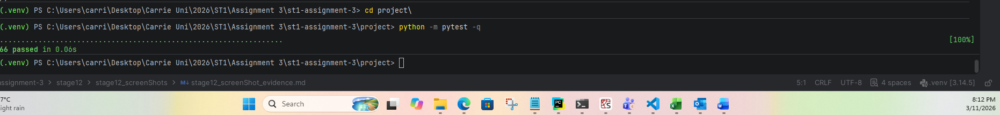

# Stage 12 activities and evidence

BLANK student response template. Supplied from the beginning in stage12/ in your EXISTING repository; complete it only when you reach Stage 12 after the previous applicable stage is integrated, verified and recorded; preserve project/, tests, earlier records and Git history. UG/common and PG/extended scope must be explicit. Use concise results and versioned links, not copied logs or source. No staff answers or fabricated approvals.

Group/tutorial: Group Exception 1
Members and UG/PG applicability: Carrie Sullivan — UG pathway; approved individual completion arrangement. Independent peer review: N/A.

## A Release scope and starting SHA

Release label/version and requirements baseline: SmartCare — Stage 12 UG course release candidate; version to be assigned after verification
Common starting SHA / branch / applicable members: 9a194c9999cff7b7905078a0e0b74f81d3747d0b / main / Carrie Sullivan
PG starting SHA / branch / applicable members or not applicable: Not applicable — UG pathway only
Working-state review and approved integration: Stage 12 evidence template has an uncommitted group-information update. No staged changes.
Protected common candidate and PG differences: UG release assessment proceeds from the integrated common Stage 9 baseline.
Feature freeze / owner / verifier: Optional feature development is frozen for release assessment. Owner: Carrie Sullivan. Verifier: N/A - approved individual completion arrangement; this activity requires another group member.

## B Requirements and release readiness matrix

Tutorial activity 1: All tests pass, README setup is incomplete, one dependency is unreviewed and a known limitation is undocumented. Do not release and justify: Although all tests are passing, release readiness also depends on complete documentation, reviewed dependencies and transparent communication of known limitations. The README setup instructions must be completed and verified, the unreviewed dependency assessed and documented, and the known limitation recorded with its impact and any required action. Relevant verification should then be repeated and the results and final release candidate recorded before sign-off.

Tutorial activity 2 and actual readiness matrix. Add exact requirement/acceptance IDs, evidence and reviewer; distinguish common/PG applicability.

| Release claim / requirement / scope                   | Evidence                                                                                                                                                                                                                                                                                                                                                                                                                                                                    | Location/link and SHA                                                                                                                                                                                                                                                                                                                                                                                                                                                                                                                                                            | Reviewer                                                                                                                                                                                                                                        | Sufficient?                                                                                                                                                                                                                                                                                                | Gap/action                                                                                                                                                                                                             |
|-------------------------------------------------------|-----------------------------------------------------------------------------------------------------------------------------------------------------------------------------------------------------------------------------------------------------------------------------------------------------------------------------------------------------------------------------------------------------------------------------------------------------------------------------|----------------------------------------------------------------------------------------------------------------------------------------------------------------------------------------------------------------------------------------------------------------------------------------------------------------------------------------------------------------------------------------------------------------------------------------------------------------------------------------------------------------------------------------------------------------------------------|-------------------------------------------------------------------------------------------------------------------------------------------------------------------------------------------------------------------------------------------------|------------------------------------------------------------------------------------------------------------------------------------------------------------------------------------------------------------------------------------------------------------------------------------------------------------|------------------------------------------------------------------------------------------------------------------------------------------------------------------------------------------------------------------------|
| Cancellation history works                            | Automated regression and workflow tests confirm cancellation changes status to CANCELLED without deleting the appointment, which remains retrievable by its original ID. Manual UI-01 demonstration also confirmed retrieval and all-status listing after cancellation.                                                                                                                                                                                                     | project/tests/test_regressions.py — test_f8_02_cancelled_appointment_remains_stored_and_retrievable; project/tests/test_workflows.py — test_workflow_books_cancels_and_retains_appointment_history; stage09/stage09_activities_and_evidence.md — UI-01. Integrated Stage 9 code checkpoint: 233a1fc1237fd244e4a39a32151851ceda46057e.                                                                                                                                                                                                                                            | Self-verified through automated tests and manual demonstration ([stage09_screenShot_evidence.md](../stage09/stage09_screenShots/stage09_screenShot_evidence.md)); independent peer review N/A under approved individual completion arrangement. | Ideally, a second set of eyes by having a reviewer plus user acceptance testing, would be best practise for this stage of the process — however, given the inidividual completion retraint this is sufficient evidence for the stated cancellation-history behaviour within the current in-memory session. | No known Stage 9 gap for this behaviour. Data is session-only and is not retained after the application exits.                                                                                                         |
| Architecture responsibilities are appropriate         | The application separates domain invariants, shared in-memory data management, service coordination, pure appointment queries and console interaction. Automated tests verify query purity, non-mutation, ordering and service workflows. The Stage 9 responsibility check documents the separation.                                                                                                                                                                        | stage09/stage09_activities_and_evidence.md — Responsibility check and Copilot review; project/README.md — Application structure; project/tests/test_queries.py, test_services.py and test_workflows.py. Integrated Stage 9 code checkpoint: 233a1fc1237fd244e4a39a32151851ceda46057e.                                                                                                                                                                                                                                                                                            | Self-verified through source review, automated tests and documented architectural assessment. Independent peer review N/A under approved individual completion arrangement.                                                                     | Yes — sufficient evidence that the application has an appropriate separation of responsibilities for its current course-assignment scope.                                                                                                                                                                  | No known architectural blocker identified. Independent review would provide additional confidence but was not available under the approved individual arrangement.                                                     |
| Rescheduling is safe — PG only                        | N/A                                                                                                                                                                                                                                                                                                                                                                                                                                                                         | N/A                                                                                                                                                                                                                                                                                                                                                                                                                                                                                                                                                                              | N/A                                                                                                                                                                                                                                             | N/A                                                                                                                                                                                                                                                                                                        | N/A                                                                                                                                                                                                                    |
| AI use is responsible — common recheck / PG assurance | Copilot suggestions were treated as review candidates rather than automatically accepted. Findings were assessed, with relevant changes modified or accepted and optional or unnecessary suggestions rejected. The resulting code was checked through the automated test suite and documented manual verification.                                                                                                                                                          | stage09/stage09_gitHub_copilot_review.md; stage09/stage09_activities_and_evidence.md; project/tests/. Integrated Stage 9 code checkpoint: 233a1fc1237fd244e4a39a32151851ceda46057e.                                                                                                                                                                                                                                                                                                                                                                                              | Self-verified through documented human assessment and subsequent testing. Independent peer review N/A under the approved individual completion arrangement.                                                                                     | Yes — sufficient evidence of responsible AI-assisted development for the stated course-assignment scope.                                                                                                                                                                                                   | No known outstanding Stage 9 AI-review action. Independent review was unavailable under the approved individual arrangement.                                                                                           |
| System is maintainable                                | The application is organised into focused modules with documented responsibilities. The duplicate run_menu() definition identified during review was removed. Named query functions, the AppointmentStatus enum and automated regression/workflow tests support readability and safer changes. The README documents the project structure and how to run the application and tests.                                                                                         | project/README.md; stage09/stage09_activities_and_evidence.md — Responsibility check and Copilot review; stage09/stage09_gitHub_copilot_review.md; project/tests/. Integrated Stage 9 code checkpoint: 233a1fc1237fd244e4a39a32151851ceda46057e.                                                                                                                                                                                                                                                                                                                                 | Self-verified through documentation review, recorded code-review decisions and automated testing. Independent peer review N/A under the approved individual completion arrangement.                                                             | Yes — sufficient evidence of maintainability for the current course-assignment scope.                                                                                                                                                                                                                      | No known maintainability blocker identified. Independent review would provide additional confidence but was unavailable under the approved individual arrangement.                                                     |
| FR-01–03 register/find and validation                 | Automated tests confirm patients and practitioners can be registered and retrieved. Lookup accepts trimmed identifiers and rejects blank, unknown and incorrectly cased identifiers. Domain validation rejects blank required fields. Duplicate registration tests confirm the original patient or practitioner record is preserved.                                                                                                                                        | project/tests/test_services.py — test_register_and_store_patient, test_register_and_store_practitioner, patient and practitioner lookup tests; project/tests/test_domain.py — blank required-field validation tests. Integrated Stage 9 code checkpoint: 233a1fc1237fd244e4a39a32151851ceda46057e.                                                                                                                                                                                                                                                                               | 	Self-verified through automated tests and review of the recorded test evidence. Independent peer review N/A under the approved individual completion arrangement.                                                                               | Yes — sufficient evidence for registration, lookup and validation within the current in-memory application scope.                                                                                                                                                                                          | No known outstanding functional gap identified for these requirements. Records remain session-only and are not retained after application exit.                                                                        |
| FR-04–05 booking/conflict rules                       | Automated tests confirm valid appointments can be booked and retrieved. Duplicate appointment IDs and bookings involving unknown participants are rejected. A second appointment for the same practitioner at the same date and time is rejected without changing stored appointments, while a different practitioner can be booked at that time. A cancelled appointment's slot can also be booked again.                                                                  | project/tests/test_services.py — test_book_and_retrieve_appointment; project/tests/test_regressions.py — test_f8_01_same_practitioner_conflict_and_different_practitioner_allowed; project/tests/test_workflows.py — test_same_practitioner_and_time_conflict_is_rejected_without_changes, test_different_practitioners_can_have_appointments_at_same_time, test_unknown_patient_booking_is_rejected_without_changing_appointments, test_cancelled_slot_can_be_booked_again_for_same_practitioner. Integrated Stage 9 code checkpoint: 233a1fc1237fd244e4a39a32151851ceda46057e. | Self-verified through automated regression and workflow tests. Independent peer review N/A under the approved individual completion arrangement.                                                                                                | Yes — sufficient evidence for booking and practitioner conflict behaviour within the current in-memory application scope.                                                                                                                                                                                  | No known outstanding functional gap identified for these booking rules. Appointment data remains session-only.                                                                                                         |
| FR-06–08 cancellation/history/find                    | Automated tests confirm a scheduled appointment can be cancelled, its status changes to CANCELLED, and the original appointment remains stored and retrievable by its ID. Cancelled appointments remain visible in all-status history but are excluded from scheduled-only listings. Unknown IDs, blank IDs and repeated cancellation attempts are rejected. Manual UI-01 verification also confirmed cancellation, retrieval and history listing.                          | project/tests/test_regressions.py — test_f8_02_cancelled_appointment_remains_stored_and_retrievable; project/tests/test_services.py — cancellation and lookup tests; project/tests/test_workflows.py — test_workflow_books_cancels_and_retains_appointment_history and test_cancelled_appointment_is_excluded_from_scheduled_listing; stage09/stage09_activities_and_evidence.md — UI-01; stage09/stage09_screenShots/stage09_screenShot_evidence.md. Integrated Stage 9 code checkpoint: 233a1fc1237fd244e4a39a32151851ceda46057e.                                              | Self-verified through automated tests and documented manual demonstration. Independent peer review N/A under the approved individual completion arrangement.                                                                                    | Yes — sufficient evidence for cancellation, retrieval and history behaviour within the current in-memory session.                                                                                                                                                                                          | No known outstanding functional gap identified. Appointment history is not retained after the application exits because persistence is outside the assignment scope.                                                   |
| FR-09 and QRY/FP listing/filter/order/purity          | Automated tests confirm practitioner appointment listings include all statuses by default and support explicit status filtering. Known practitioners with no appointments receive an empty list, while unknown practitioners and invalid inputs are rejected. Query tests verify deterministic ordering by date/time and appointment ID, filtering, a new result list, and no mutation of the source collection or appointment records.                                     | project/tests/test_queries.py — practitioner filtering, status filtering, ordering and non-mutation tests; project/tests/test_services.py — practitioner listing, status filtering, empty results and validation tests; project/tests/test_workflows.py — listing workflow tests; stage09/stage09_activities_and_evidence.md — Stage 9 query and test evidence. Integrated Stage 9 code checkpoint: 233a1fc1237fd244e4a39a32151851ceda46057e.                                                                                                                                    | 	Self-verified through automated query, service and workflow tests. Independent peer review N/A under the approved individual completion arrangement.                                                                                            | Yes — sufficient evidence for practitioner listing and pure query behaviour within the current assignment scope.                                                                                                                                                                                           | No known outstanding functional gap identified. The query functions operate on in-memory appointment data and do not provide persistence.                                                                              |
| UI full console sequence and error recovery           | Manual demonstrations confirmed that users could register and find patients and practitioners, book and cancel appointments, retrieve appointment history and list practitioner appointments. Invalid menu choices, blank and duplicate identifiers, unknown patients and appointments, malformed dates, invalid statuses and repeated cancellation attempts produced errors without terminating the session. A subsequent valid booking succeeded after rejected attempts. | stage09/stage09_activities_and_evidence.md — UI-01 and UI-02; stage09/stage09_screenShots/ and stage09/stage09_screenShot_evidence.md; project/README.md — interactive run instructions. Integrated Stage 9 code checkpoint: 233a1fc1237fd244e4a39a32151851ceda46057e.                                                                                                                                                                                                                                                                                                           | Self-verified through documented manual console demonstrations and supporting automated tests. Independent peer review N/A under the approved individual completion arrangement.                                                                | Yes — sufficient evidence for the demonstrated console workflows and expected error recovery within the current assignment scope.                                                                                                                                                                          | No known outstanding Stage 9 console blocker identified. A separate automated subprocess test of the complete interactive menu was not added; the documented manual demonstrations provide the console-level evidence. |
| Session-only scope / FR-10 retired                    | The application stores patients, practitioners and appointments in shared in-memory data structures during a menu session. The README documents that data is lost when the application exits and that no database or persistent storage is provided. The Stage 9 scope records FR-10 as retired.                                                                                                                                                                            | project/README.md — application limitations and session-only data; stage09/stage09_activities_and_evidence.md — requirements and scope decisions; project/data_store.py — in-memory storage implementation. Integrated Stage 9 code checkpoint: 233a1fc1237fd244e4a39a32151851ceda46057e.                                                                                                                                                                                                                                                                                        | Self-verified through documentation and implementation review. Independent peer review N/A under the approved individual completion arrangement.                                                                                                | Yes — sufficient evidence that session-only storage is understood, documented and consistent with the common assignment scope.                                                                                                                                                                             | No release blocker for the stated course scope. Persistent storage remains outside scope; data is not retained between application sessions.                                                                           |
| PG RES and assurance integration                      | N/A                                                                                                                                                                                                                                                                                                                                                                                                                                                                         | N/A                                                                                                                                                                                                                                                                                                                                                                                                                                                                                                                                                                              | N/A                                                                                                                                                                                                                                             | N/A                                                                                                                                                                                                                                                                                                        | N/A                                                                                                                                                                                                                    |

## C Full regression results

| Suite/scope                              | Environment/version                                                                                             | Working directory and command  | Tested SHA                               | Actual result                                    | Evidence link                                                                                                                  |
|------------------------------------------|-----------------------------------------------------------------------------------------------------------------|--------------------------------|------------------------------------------|--------------------------------------------------|--------------------------------------------------------------------------------------------------------------------------------|
| Complete common                          | Python 3.14.5; pytest 8.3.5. Teaching team specified Python 3.13; Python 3.14.5 used due to setup difficulties. | project/ — python -m pytest -q | 9a194c9999cff7b7905078a0e0b74f81d3747d0b | 66 passed in 0.06s                               | C1 complete common regression screenshot -  |
| Complete PG if applicable                | N/A                                                                                                             | N/A                            | N/A                                      | N/A                                              | N/A                                                                                                                            |
| Affected focused checks after correction | N/A — No Stage 12 code or test corrections required.                                                            | N/A                            | N/A                                      | N/A                                              | N/A                                                                                                                            |
| Full integrated recheck                  | Python 3.14.5; pytest 8.3.5                                                                                     | project/ — python -m pytest -q | 9a194c9999cff7b7905078a0e0b74f81d3747d0b | 66 passed in 0.06s — same run as complete common | C1 screenshot - link provided at complete common                                                                               |
Prior assertions preserved / reviewed test diff: No Stage 12 code or test changes were made. Existing test assertions were preserved; no test modifications or removals were required.
Remaining failure / limitation: No test failures in the complete common regression suite (66 passed). The verification environment used Python 3.14.5 rather than the teaching team's specified Python 3.13 because of environment setup difficulties. Pytest 8.3.5 matched the pinned development dependency. Application data remains session-only and is lost when the process exits; persistent storage is outside the UG assignment scope.

## D Console and end to end demonstration

| Demo step                                                        | Synthetic setup/input                                                                                                                                                                                                                                        | Expected requirement                                                                                                                                                                                                                                                        | Observed result                                                                                                                                                                                                                                                                                                                                                                                                                                                                                                                                                                                                 | Evidence/link                                                                                                                                          |
|------------------------------------------------------------------|--------------------------------------------------------------------------------------------------------------------------------------------------------------------------------------------------------------------------------------------------------------|-----------------------------------------------------------------------------------------------------------------------------------------------------------------------------------------------------------------------------------------------------------------------------|-----------------------------------------------------------------------------------------------------------------------------------------------------------------------------------------------------------------------------------------------------------------------------------------------------------------------------------------------------------------------------------------------------------------------------------------------------------------------------------------------------------------------------------------------------------------------------------------------------------------|--------------------------------------------------------------------------------------------------------------------------------------------------------|
| Problem and stakeholders                                         | SmartCare is a synthetic appointment-management application. No real patient or clinical information is used.                                                                                                                                                | Explain the problem being addressed and identify the clinic-side stakeholders who need the system.                                                                                                                                                                          | The application supports clinic-side registration and lookup of patients and practitioners, appointment booking, conflict prevention, cancellation, appointment history and practitioner appointment listings. Relevant stakeholders include patients, practitioners and clinic reception or administrative staff responsible for managing appointments.                                                                                                                                                                                                                                                        | project/README.md — project purpose and supported functionality; Stage 12 demonstration record.                                                        |
| Register and find Patient and two Practitioners                  | Registered patient P900, practitioners D100 and D200; looked up P900 and D100.                                                                                                                                                                               | FR-01, FR-02 and FR-03: register patients and practitioners with required details and unique IDs; find records by ID.                                                                                                                                                       | 	All three registrations succeeded. Patient P900 and practitioner D100 were found with the expected details. Menu returned after each operation.                                                                                                                                                                                                                                                                                                                                                                                                                                                                 | D2 images in [stage12_screenShot_evidence.md](stage12_screenShots/stage12_screenShot_evidence.md)                                                      |
| Valid booking                                                    | Appointment A1; patient P900; practitioner D100; 2026-11-04 09:00.                                                                                                                                                                                           | 	FR-04 / AC-03.1: book an appointment linking registered participants using a unique appointment ID, with an available date/time.                                                                                                                                            | Appointment A1 was successfully booked and displayed with the expected patient, practitioner, date/time and scheduled status.                                                                                                                                                                                                                                                                                                                                                                                                                                                                                   | D3 image in [stage12_screenShot_evidence.md](stage12_screenShots/stage12_screenShot_evidence.md)                                                       |
| Same practitioner exact-time conflict rejected                   | Attempted A3 for P900 with D100 at 2026-11-04 09:00, while A1 was already scheduled for D100 at that time.                                                                                                                                                   | Reject another SCHEDULED appointment for the same practitioner at the exact same date/time.                                                                                                                                                                                 | Booking was rejected with: Practitioner already has a SCHEDULED appointment at this time.                                                                                                                                                                                                                                                                                                                                                                                                                                                                                                                       | D4 image in [stage12_screenShot_evidence.md](stage12_screenShots/stage12_screenShot_evidence.md)                                                       |
| Different practitioner same time allowed                         | A4; patient P900; practitioner D200; 2026-11-04 09:00, the same time as A1 with D100.                                                                                                                                                                        | BR-05 / AC-04.2: a different practitioner may be booked at the same time.                                                                                                                                                                                                   | Appointment A4 was successfully booked with status scheduled.                                                                                                                                                                                                                                                                                                                                                                                                                                                                                                                                                   | D5 image in [stage12_screenShot_evidence.md](stage12_screenShots/stage12_screenShot_evidence.md)                                                       |
| Cancel SCHEDULED and retain/find CANCELLED object                | Cancelled scheduled appointment A1, then searched for A1 by appointment ID.                                                                                                                                                                                  | Cancel only a scheduled appointment and retain the same appointment with CANCELLED status in current-session history.                                                                                                                                                       | Cancellation succeeded. A subsequent lookup found A1 with the same details and cancelled status.                                                                                                                                                                                                                                                                                                                                                                                                                                                                                                                | D6 image in [stage12_screenShot_evidence.md](stage12_screenShots/stage12_screenShot_evidence.md)                                                       |
| Invalid/repeated cancellation rejected                           | Attempted to cancel A1 a second time after it had already been cancelled.                                                                                                                                                                                    | Reject cancellation when the appointment is not SCHEDULED.                                                                                                                                                                                                                  | Operation rejected with Only SCHEDULED appointments may be cancelled. A1 remained cancelled.                                                                                                                                                                                                                                                                                                                                                                                                                                                                                                                    | D7 image in [stage12_screenShot_evidence.md](stage12_screenShots/stage12_screenShot_evidence.md)                                                       |
| Default all-status listing                                       | Listed appointments for D100 and left the status prompt blank.                                                                                                                                                                                               | FR-09: default listing includes all appointment statuses, including cancelled history, in ascending date/time and appointment ID order.                                                                                                                                     | A2 (scheduled) and A1 (cancelled) were both displayed, with the earlier date first.                                                                                                                                                                                                                                                                                                                                                                                                                                                                                                                             | D8 image in [stage12_screenShot_evidence.md](stage12_screenShots/stage12_screenShot_evidence.md)                                                       |
| Explicit filtering / empty vs unknown / deterministic order      | Listed D100 appointments using the explicit scheduled filter; listed D200 appointments using cancelled; attempted a listing for unregistered practitioner D300; also listed all D100 appointments with a blank status filter.                                | FR-09 and the practitioner-listing query contract: filter by practitioner and optional status; return an empty list when a known practitioner has no matching appointments; distinguish an unknown practitioner; order results by ascending date/time, then appointment ID. | D100 with scheduled displayed A2 and excluded cancelled A1. D200 with cancelled displayed No matching appointments found. D300 produced Practitioner not found. The all-status D100 listing displayed the earlier appointment before the later one. Automated query tests verify the appointment-ID tie-break and filtering/order behaviour.                                                                                                                                                                                                                                                                    | D9 image in [stage12_screenShot_evidence.md](stage12_screenShots/stage12_screenShot_evidence.md)                                                       |
| Invalid date/status/menu/lookup recovery and continued operation | Entered invalid menu choice 9; attempted booking A5 using malformed date/time 05/11/2026 9:00; attempted practitioner listing for D100 with invalid status booked; searched for nonexistent appointment A900; then successfully looked up practitioner D200. | Invalid menu, date/time, status and lookup inputs should be rejected with understandable errors. The interactive application should remain usable after each rejected operation.                                                                                            | Menu choice rejected with Unknown menu choice. Please choose a listed option. Malformed date rejected with Use date/time format YYYY-MM-DD HH:MM. Invalid status rejected with Status must be scheduled, cancelled or completed. Unknown appointment rejected with Appointment not found. The application continued and successfully found D200.                                                                                                                                                                                                                                                                | D10 image in [stage12_screenShot_evidence.md](stage12_screenShots/stage12_screenShot_evidence.md)                                                      |
| Session-only limitation and normal exit                          | Used menu option 0 to exit the interactive SmartCare application after completing the demonstration workflow.                                                                                                                                                | Application should exit normally and clearly communicate that records are held in memory only and are lost when the process ends. FR-10 is retired; persistence is not required.                                                                                            | Application displayed Session ended. In-memory records are lost on exit. and terminated normally.                                                                                                                                                                                                                                                                                                                                                                                                                                                                                                               | D11 image in [stage12_screenShot_evidence.md](stage12_screenShots/stage12_screenShot_evidence.md)                                                      |
| One meaningful requirement-linked pytest test explained          | Automated test creates appointment A1 using registered synthetic patient and practitioner records, cancels it, then retrieves it by appointment ID.                                                                                                          | FR-06, FR-07 and FR-08; AC-05.1 and AC-05.2. Cancellation changes status without deleting the appointment, which remains retrievable during the current session.                                                                                                            | Assertions confirm the same appointment object is returned, its status is CANCELLED, it remains in the data store, and both the data-store and service lookup methods retrieve that same object.                                                                                                                                                                                                                                                                                                                                                                                                                | project/tests/test_regressions.py — test_f8_02_cancelled_appointment_remains_stored_and_retrievable; Stage 12 integrated regression result: 66 passed. |
| Architecture and one actual AI decision / known limitation       | Reviewed the SmartCare module structure, Stage 9 GitHub Copilot review and the integrated regression evidence.                                                                                                                                               | Explain the separation of responsibilities between modules, identify an actual AI-assisted development decision and human verification, and acknowledge a known course-release limitation.                                                                                  | domain.py defines the domain entities and rules; data_store.py manages in-memory records; services.py coordinates operations and validation; queries.py provides pure filtering and sorting; console.py handles user input, output and menu interaction. GitHub Copilot identified duplicate run_menu() definitions and a status-parsing issue. The duplicate was removed and status parsing corrected. The changes were human-reviewed and verified through the regression suite. A known limitation is that records are session-only and are lost on exit; persistent storage is outside the UG requirements. | project/README.md; stage09/stage09_gitHub_copilot_review.md; Stage 12 regression results (66 passed).                                                  |
| PG reschedule identity/participants/time and no-op               | N/A                                                                                                                                                                                                                                                          | N/A                                                                                                                                                                                                                                                                         | N/A                                                                                                                                                                                                                                                                                                                                                                                                                                                                                                                                                                                                             | N/A                                                                                                                                                    |
| PG conflict/invalid status/failure non-mutation                  | N/A                                                                                                                                                                                                                                                          | N/A                                                                                                                                                                                                                                                                         | N/A                                                                                                                                                                                                                                                                                                                                                                                                                                                                                                                                                                                                             | N/A                                                                                                                                                    |
| PG old slot / current lookup/list ordering / assurance risks     | N/A                                                                                                                                                                                                                                                          | N/A                                                                                                                                                                                                                                                                         | N/A                                                                                                                                                                                                                                                                                                                                                                                                                                                                                                                                                                                                             | N/A                                                                                                                                                    |
Stable demo owner / fresh process / command: Owner: Carrie Sullivan. Demonstration performed individually in a fresh interactive SmartCare process using synthetic in-memory data. Command: python main.py --interactive, run from the project/ working directory. The process was exited normally using menu option 0. Screenshots captured during the demonstration are recorded in the Stage 12 screenshot evidence.
PG demonstrations through service/tests or not applicable: N/A

## E Final code quality and AI review

| Review area                                                     | Code/evidence location                                                                                    | Finding or no finding                                                                                                                                                                                                                                                                                                           | Correction/no change and recheck                                                                                                                                                                                                                             |
|-----------------------------------------------------------------|-----------------------------------------------------------------------------------------------------------|---------------------------------------------------------------------------------------------------------------------------------------------------------------------------------------------------------------------------------------------------------------------------------------------------------------------------------|--------------------------------------------------------------------------------------------------------------------------------------------------------------------------------------------------------------------------------------------------------------|
| OOP responsibilities and pure-query boundaries                  | project/smartcare/domain.py, data_store.py, services.py, queries.py, console.py                           | Responsibilities are appropriately separated. Domain entities own local validation/state transitions; the store owns in-memory collections; services coordinate workflows and cross-object rules; queries are pure functions; console handles input/output. Two service lookup docstrings retain obsolete Stage 6 TODO wording. | Keep the architecture unchanged. Update the two obsolete lookup docstrings to describe their implemented behaviour. No functional change intended.                                                                                                           |
| PascalCase and snake_case naming                                | project/smartcare/ modules, particularly domain.py, data_store.py, services.py, queries.py and console.py | No inconsistent naming identified in the reviewed code. Classes use PascalCase; functions, methods and variables use snake_case.                                                                                                                                                                                                | No change required. Naming is clear and consistent with Python conventions.                                                                                                                                                                                  |
| Useful type hints and meaningful docstrings                     | project/smartcare/domain.py, data_store.py, services.py, queries.py, console.py                           | Type hints clearly describe important parameters and return values. Docstrings explain responsibilities and expected behaviour. Two obsolete Stage 6 TODO docstrings were identified and removed.                                                                                                                               | Updated the two lookup docstrings. No further changes identified. No functional behaviour changed.                                                                                                                                                           |
| Four-space indentation and imports/layout                       | All modules in project/smartcare/                                                                         | No indentation or import-layout issues identified during review. Code uses four-space indentation and explicit module imports.                                                                                                                                                                                                  | No change required.                                                                                                                                                                                                                                          |
| Focused methods / duplication / dead or commented code          | project/smartcare/ modules; Stage 9 Copilot review record                                                 | No further duplication, dead code or commented-out code identified. The duplicate run_menu() definition had already been removed during Stage 9.                                                                                                                                                                                | No additional correction required. Existing regression evidence remains 66 passed; no Stage 12 functional code change was made.                                                                                                                              |
| Globals / leakage / unnecessary inheritance or frameworks       | project/smartcare/ modules                                                                                | No inappropriate mutable globals, responsibility leakage, unnecessary inheritance or frameworks identified in the reviewed project. Services receive the shared store through constructors.                                                                                                                                     | No change required.                                                                                                                                                                                                                                          |
| No SQLite/persistence/repository ABCs/speculative features      | project/smartcare/data_store.py, project/README.md, requirements baseline                                 | No out-of-scope persistence or speculative architecture identified. The application uses in-memory records for the current session, consistent with retired FR-10.                                                                                                                                                              | No change required. Retain the documented session-only limitation.                                                                                                                                                                                           |
| Synthetic data / secrets / dependencies / provenance            | project/requirements-dev.txt, demo data, repository files and Git changes                                 | No concerns identified. Data is synthetic; no committed secrets or unexplained dependencies/copying found.                                                                                                                                                                                                                      | No change required. Dependency remains pinned to pytest==8.3.5.                                                                                                                                                                                              |
| Significant common Copilot contributions and human verification | stage09/stage09_gitHub_copilot_review.md, Stage 9 code changes and regression evidence                    | No Copilot use during Stage 12. The Stage 9 review identified duplicate run_menu() definitions and incorrect status parsing, along with testing and optional quality suggestions. Human review assessed the suggestions and relevant corrections were made                                                                      | Duplicate menu definition removed and status parsing corrected. Human verification included review of the changes and the integrated regression suite (66 passed). Copilot was used as an advisory tool, not as an independent reviewer or release approver. |
| PG plan/diff/test approvals and Stage 11 VERIFY/TRUST           | N/A                                                                                                       | N/A                                                                                                                                                                                                                                                                                                                             | N/A                                                                                                                                                                                                                                                          |

| AI claim                                                                           | Affected requirement/code                                   | Human check                                                                                                 | Accept/Modify/Reject and reason                                                               | Actual outcome/action or no change                                                                                                              |
|------------------------------------------------------------------------------------|-------------------------------------------------------------|-------------------------------------------------------------------------------------------------------------|-----------------------------------------------------------------------------------------------|-------------------------------------------------------------------------------------------------------------------------------------------------|
| Duplicate run_menu() definitions could cause one implementation to shadow another. | project/smartcare/console.py; interactive menu requirements | Inspected both definitions and confirmed the duplicate implementation and its effect.                       | Accept — the duplicate was a genuine maintainability and correctness risk.                    | Removed the duplicate definition; retained the intended complete menu.                                                                          |
| Status parsing in the menu was incorrect/inconsistent.                             | project/smartcare/console.py; FR-09 status filtering        | Inspected the input conversion and checked the corrected enum handling against the supported status values. | Modify — retained enum conversion but corrected the blank-status and invalid-status handling. | Blank input maps to None; valid values map to AppointmentStatus; invalid values raise a clear ValueError. Regression suite subsequently passed. |
Access route or approved equivalent / limitations: The Stage 9 GitHub Copilot review record is the available evidence. No additional Copilot review was performed during Stage 12.
Available AI evidence and missing evidence honestly disclosed: Stage 9 review findings and human decisions are documented. No Stage 12 Copilot transcript or additional AI review exists. Independent peer review was unavailable under the approved individual completion arrangement.

## F README and reproducibility check

| README item                                                   | Location                                                                               | Verifier                                                                                       | Result/gap                                                                                                                                                                                                                                                                                     |
|---------------------------------------------------------------|----------------------------------------------------------------------------------------|------------------------------------------------------------------------------------------------|------------------------------------------------------------------------------------------------------------------------------------------------------------------------------------------------------------------------------------------------------------------------------------------------|
| Purpose and included common/PG scope                          | project/README.md — Application functionality and Data and limitations                 | N/A - approved individual completion arrangement; this activity requires another group member. | The README describes the SmartCare application and its common capabilities. It explicitly states that PG rescheduling is not included. No change required.                                                                                                                                     |
| Out-of-scope capabilities and known limitations               | project/README.md — Data and limitations; Validation and behaviour                     | N/A - approved individual completion arrangement; this activity requires another group member. | Synthetic data only; records are held in memory and lost when the application exits; FR-10 restart persistence is retired; PG rescheduling is excluded. The README also identifies rules that do not apply, including age, duration, patient-conflict and past-date rules. No change required. |
| Confirmed teaching Python version and dependency installation | project/README.md — environment and dependency instructions                            | N/A - approved individual completion arrangement; this activity requires another group member. | README wording corrected to distinguish the teaching team's specified Python 3.13 environment from the actual Stage 12 verification environment: Python 3.14.5 with pytest 8.3.5. Dependency installation instructions are documented.                                                         |
| Working directory / demo / interactive / test commands        | project/README.md — Working directory and commands                                     | N/A - approved individual completion arrangement; this activity requires another group member. | Working directory is project/. Demo, interactive, test and dependency-installation commands are documented and were retained. No change required.                                                                                                                                              |
| Repository structure and architecture responsibilities        | project/README.md — Application structure                                              | N/A - approved individual completion arrangement; this activity requires another group member. | The five main modules and their responsibilities are documented. The shared data-store arrangement and new-list behaviour are also explained. No change required.                                                                                                                              |
| Responsible AI summary / synthetic-data rule                  | project/README.md — Data and limitations; stage09/stage09_gitHub_copilot_review.md     | N/A - approved individual completion arrangement; this activity requires another group member. | Synthetic-data-only rule is documented in the README. Significant Copilot findings, human accept/modify/reject decisions and verification are documented in the Stage 9 review record. The detailed AI record is linked by repository location rather than duplicated in the README.           |
| Release label/version and SHA links                           | stage12/stage12_activities_and_evidence.md — Section A; repository release information | N/A - approved individual completion arrangement; this activity requires another group member. | Release version/tag and final candidate SHA are pending completion of the Stage 12 checks. Starting SHA is recorded in Section A. No release label or tag assigned yet.                                                                                                                        |
Root README index and project/README verified: The root README provides a repository overview and links to project/README.md. Both README files have been reviewed. The root README contains administrative and verification details that are being updated as part of the Stage 12 release checks. Some details, including the final submitted SHA, will be completed after the final release candidate is established.
Fresh clone or extracted ZIP / candidate identity: N/A - approved individual completion arrangement; this activity requires another group member.
Verifier and clean environment / actual version: N/A - approved individual completion arrangement; this activity requires another group member.
Setup/run/test commands and observed results: Original-machine commands and results are recorded in Section C. From the project/ working directory, the test command python -m pytest -q completed with 66 passed in 0.06s using Python 3.14.5 and pytest 8.3.5. Fresh-copy setup and execution results are pending.
Missing local file or setup gap / remedy and recheck: No missing local project files have been identified during the original-machine verification. The recorded regression run used Python 3.14.5 rather than the teaching team's specified Python 3.13. Verification under Python 3.13 remains a known environment limitation; the actual environment and results will be recorded accurately.

## G Known limitations debt and release notes

Delivered features: SmartCare delivers patient and practitioner registration and lookup; appointment booking with practitioner/time conflict prevention; appointment cancellation with retained appointment history; appointment lookup; and practitioner appointment listing with optional status filtering. Appointment listings support all statuses by default and deterministic ordering by appointment date/time and appointment ID. The interactive console supports repeated operations and recovery from expected validation and lookup errors
Important fixes: Corrected practitioner appointment conflict detection so that conflicts are checked against the same practitioner. Corrected appointment lookup so cancelled appointments remain retrievable. Removed duplicate run_menu() definitions that caused one implementation to shadow the other. Corrected console status parsing so blank input selects all statuses and valid status values are converted to the enum, while invalid values produce a clear validation error.
Architecture/quality improvements: Improved separation of responsibilities across the application: domain entities handle their own validation and state transitions; the data store manages in-memory records; services coordinate application operations and business rules; pure query functions handle appointment filtering and deterministic sorting; and the console manages user interaction. Added and strengthened regression, service and query tests, including checks for cancellation history, query purity, filtering and ordering. Removed obsolete TODO docstrings and duplicate menu implementation.
Known limitations: The application uses synthetic in-memory data only. Records are lost when the application exits; persistent storage is not implemented, as FR-10 was retired from the UG requirements baseline. The application uses local, naive date/time values with minute precision and does not implement timezone handling. It is a console-based course application and has not been evaluated or certified for production healthcare use.
AI-assisted development note: GitHub Copilot was used during Stage 9 as an advisory code-review aid. Its prompt, findings and the human accept/modify/reject decisions are recorded in stage09/stage09_gitHub_copilot_review.md. Significant findings included duplicate run_menu() definitions and incorrect console status parsing. These were reviewed, corrected and checked through the regression suite. Optional suggestions were assessed and not adopted where existing tests or manual evidence already provided sufficient coverage, or where the proposed change was unnecessary. AI output was not treated as independent review or release approval. Other AI use was for succinct summarisation of my analysis.

| Debt item | Impact | Priority | Future action | Accepted? / release rationale |
|---|---|---|---|---|
| No automated subprocess tests for the complete interactive console menu | Menu navigation and input-recovery behaviour rely partly on manual verification, so future console regressions may be less readily detected by automated tests. | Low | Consider adding automated console integration tests in future development. | Accepted for this UG course release. Manual interactive evidence and automated service/workflow tests provide supporting verification. |
Session-only synthetic data and minute-precision local time: SmartCare uses synthetic patient, practitioner and appointment records held in memory for the duration of an application session. Records are lost when the application exits. Appointment date/time values use local, naive datetime values with minute precision; timezone-aware handling and timezone conversion are not implemented. These are accepted limitations of the UG course scope, not unresolved defects against the current requirements baseline.
Production auth/roles, portal, notifications, billing/insurance, clinical AI exclusions: Production authentication and role-based access control, a patient portal, SMS/email notifications, billing and insurance processing, and clinical decision-support or clinical AI capabilities are not implemented. SmartCare is an appointment-management application, not a healthcare system. These capabilities are outside the current UG assignment scope and would require separate requirements, design, security assessment before any future implementation.
Scale/concurrency, timezone policy, operations/monitoring, accessibility/usability limitations: SmartCare has not been designed or tested for enterprise-scale use or concurrent multi-user operation. It has no defined timezone policy, production deployment or operational monitoring. Accessibility and usability have not been formally evaluated. These limitations are accepted within the UG course scope and would need consideration in any future development beyond the assignment.
Difference between accepted scope limit and unresolved required behaviour: The limitations recorded above are deliberate exclusions or constraints of the UG assignment scope, not known failures of the current requirements baseline. The required common functionality has passed the recorded regression suite (66 tests passed) and the interactive demonstration. No unresolved required functional defects are currently known.
PG assurance residual risks / owner / status or not applicable: N/A

## H Release findings and corrective action

| Requirement/claim | Reproduction/observation | Impact/severity | Owner/action | Corrective diff | Focused/full recheck | Residual limit |
|---|---|---|---|---|---|---|
| FR-05 / BR-05 — practitioner appointment conflict prevention | Stage 8 review identified incorrect practitioner ID comparison in has_practitioner_conflict(). | High — could incorrectly reject valid bookings and fail to reject conflicting bookings. | Carrie Sullivan — corrected the comparison. | Stage 8 repair commit cc00eb4. | Regression tests and integrated suite; Stage 12 full suite: 66 passed. | No known remaining defect in this behaviour. |
| FR-08 — appointment history retrieval | Stage 8 review identified that find_appointment() excluded cancelled appointments. | High — cancelled appointment history could not be retrieved. | Carrie Sullivan — removed the inappropriate cancelled-status exclusion. | Stage 8 repair commit cc00eb4. | Regression test test_f8_02_cancelled_appointment_remains_stored_and_retrievable; full suite: 66 passed. | Records remain session-only. |
| Console menu and status handling | Stage 9 Copilot review identified duplicate run_menu() definitions and incorrect status parsing in the active menu implementation. | Medium — intended menu behaviour could be shadowed and status filtering could fail. | Carrie Sullivan — removed duplicate implementation and corrected parsing.| Stage 9 corrective commits on feature/stage9-queries. | Console manual demonstration and full suite: 66 passed. | No automated subprocess test of the complete console menu. |
Justified no-change conclusion if no defect found: Stage 12 inspection and verification identified no new unresolved functional defects. Previously identified Stage 8 and Stage 9 defects were corrected and documented, with regression coverage and successful integrated testing. The Stage 12 interactive demonstration also exercised registration, booking, conflict prevention, cancellation, history retrieval, filtering and error recovery. No further corrective code changes are considered necessary at this review point.
Release blockers still open / status: No known unresolved functional blockers. Final release assurance remains subject to completion of the remaining Stage 12 checks, including final Git review and the human release decision.

## I Git review and integration evidence

Issue / PR / diff links and reviewed SHA: Stage 8 and Stage 9 implementation and documentation changes were integrated into the common main branch through the recorded pull requests. Stage 12 regression verification was performed against commit 9a194c9999cff7b7905078a0e0b74f81d3747d0b. No commits have been made since that verification. Stage 12 evidence and documentation changes remain separate from the tested application code.
Independent reviewer / feedback / response: N/A - approved individual completion arrangement; this activity requires another group member.
Integration commit / full recheck: Stage 8 and Stage 9 changes were integrated into the common main branch. The current tested integration commit is 9a194c9999cff7b7905078a0e0b74f81d3747d0b. The complete regression suite was run from project/ using python -m pytest -q, with 66 tests passing in 0.06 seconds.
Tracked and untracked file inspection / cleanliness: Git status was inspected. README files, Stage 12 evidence documentation and screenshots contain uncommitted changes. project/smartcare/services.py has a documentation-only change removing an obsolete Stage 6 TODO docstring; no executable behaviour was changed. The current HEAD remains 9a194c9999cff7b7905078a0e0b74f81d3747d0b.
Secrets/staff material/caches/tool-metadata exclusion check: The release materials were reviewed for real patient or practitioner data, credentials, secrets, staff-only material, caches, virtual environments, temporary files and unnecessary tool or recovery metadata. The application and demonstration use synthetic data only. No such material is intended for inclusion in the release.
Candidate recovery plan / known-good SHA: The known-good integrated code commit is 9a194c9999cff7b7905078a0e0b74f81d3747d0b on main.
Named substantive contributions: I, Carrie Sullivan completed the implementation, testing, documentation, demonstrations and integration under the tutor-approved individual completion arrangement. No other member contributions are claimed.

## J Human release decision

Decision — READY FOR COURSE RELEASE / READY WITH DOCUMENTED LIMITATIONS / NOT YET READY: READY FOR COURSE RELEASE
Approver / date / rationale and evidence: Approver: Carrie Sullivan, under the tutor-approved individual completion arrangement. Date: 5 November 2026. The release decision is based on the completed Stage 12 requirements and evidence review, the integrated regression result of 66 tests passing, the interactive console demonstration, the code-quality and AI review, and the documented Git integration and recovery point. The Python 3.14.5 environment with pytest 8.3.5 was checked and accepted for this course release.
What risks remain / conditions / owners: The application uses synthetic in-memory data and does not provide persistence. It is a console-based course application and has not been assessed for production healthcare use. Independent fresh-copy/ZIP verification by another group member was not possible under the approved individual completion arrangement. These limitations are recorded in the Stage 12 evidence. Owner: Carrie Sullivan.
Can the team explain the system: SmartCare is a console-based appointment management system. The console handles user interaction, services coordinate operations, the domain defines the main entities, and the data store holds records in memory. The query module filters and sorts appointments without changing the original records.

When booking, the system checks that the patient and practitioner exist and that the practitioner has no other scheduled appointment at that exact time. When cancelling, the status changes to cancelled, but the appointment remains in the system so it can still be retrieved from history.
Can a change be recovered: The known-good tested commit 9a194c9999cff7b7905078a0e0b74f81d3747d0b on main is retained as the recovery point. Later changes can be reviewed against this commit and the tested source can be recovered from it.
Common decision / PG decision where different: Common UG release: READY FOR COURSE RELEASE.

## K Final tested release SHA

Exact common tested SHA: 9a194c9999cff7b7905078a0e0b74f81d3747d0b
Exact PG tested SHA or not applicable: N/A
Final submitted SHA / repository URL: Final submitted SHA pending the final evidence commit and ZIP verification. Repository: https://github.com/carrie-mack-sulli/st1-assignment-3
Evidence-only later commit and difference explanation: The original Stage 12 regression-tested code SHA is 9a194c9999cff7b7905078a0e0b74f81d3747d0b. Release-preparation commit c012c8933dd9ef28fd8dfb436c39aa9e41f09352 adds Stage 12 documentation, screenshots and README updates, and removes obsolete TODO docstrings from services.py. No executable behaviour was changed. The final submitted SHA will be recorded after the final evidence commit.
Executable changes after testing and re-verification: No executable behaviour changes have been made since the full regression run. The subsequent services.py change is documentation-only. No additional functional re-verification was required for that change.
Source ZIP name / SHA correspondence / extracted comparison: SmartCare-release.zip — planned export from the exact final submitted SHA. ZIP creation, extraction and comparison are pending. Independent verification by another group member is N/A under the approved individual completion arrangement; the ZIP will be checked individually.

## L Submission package verification

- [x] Feature freeze and scoped requirements traced.
- [x] Applicable full regressions, integrated demo and invalid paths verified.
- [x] Architecture/code quality and final AI/dependency checks complete.
- [ ] Root README and project/README reproduced by another verifier. - N/A - approved individual completion arrangement; this activity requires another group member.
- [x] Release notes, technical debt and limitations visible.
- [x] Independent human review, integration and release decision recorded.
- [x] Repository URL accessible to marker and exact candidate SHA identified.
- [ ] One source ZIP from submitted commit with root README.md and .gitignore.
- [ ] project/ source and all accumulated applicable tests included.
- [ ] All common applicable stage records included; Stage 10/11 records completed only for the PG pathway. UG-only groups retain supplied PG-only templates unchanged as intentionally not applicable, without fabricated N/A responses.
- [ ] No .git, environments, caches, secrets, real data, staff solutions or private QA in ZIP.
- [ ] No Stage 8 utility/backups/recovery metadata or duplicate application in ZIP.
- [ ] Mixed-group common protection and candidate upload routing checked.
- [ ] Group reflection, confidential individual peer forms and common team viva routed separately.

Confirmed assessment item/upload route: Assignment 3 submission via Canvas using GitHub repository url.
Deadline/timezone: Original due date and time of 6 November 2026 23:59. Updated due date and time of 9 November 2026 23:59 Canberra AEDT.
Repository access arrangement: GitHub repository named st1-assignment-3 within account of carrie-mack-sulli set to Public. Link supplied in root README.
Mixed-candidate upload arrangement: N/A. I will upload individually.
Oral/video recording/accessibility arrangements: I will complete the oral portion of the assignment individually.
Remaining administration or release dependency: Finalise and commit the Stage 12 documentation and evidence, record the final submitted SHA, generate and verify the source ZIP from that commit, and submit the GitHub repository URL through Canvas by the confirmed deadline. The separate reflection and oral assessment activities will be completed through their respective Canvas assignments when they open on 9 November 2026.

## M Formative questions

1. What is a release candidate? A release candidate is a version of the software that is considered ready for final verification before submission or release. It should contain the intended features, have its changes reviewed and be tested so that any remaining issues can be identified before the final release.

2. What is feature freeze and why is it used? Feature freeze is when no new features are added to the software so the team can focus on testing, fixing important defects and preparing the final release. It helps keep the software stable and reduces the risk of introducing new problems close to submission.

3. What is regression testing in a release context? Regression testing means rerunning existing tests after changes to make sure previously working features still behave correctly. Before release, it helps confirm that defect fixes or other changes have not introduced new problems elsewhere in the system.

4. What is a known limitation? A known limitation is a feature or capability that the software does not support, or a restriction on how it can be used. It is documented so users understand what the system can and cannot do.

5. What is technical debt? Technical debt is work that may need to be improved or addressed in the future because of earlier design or implementation decisions. It can include limited test coverage, duplicated code or shortcuts that make maintenance harder.

6. What are release notes? Release notes document what a software version delivers, including its features, important fixes, improvements and known limitations. They help users and maintainers understand what is included in the release and any issues or restrictions they should be aware of.

7. What is software maintenance? Software maintenance is the work done after release to keep software working correctly and useful. It includes fixing defects, improving performance, updating dependencies and adapting the system to any necessary environment changes. New requirements would be covered under an enhancement.

8. What is the purpose of the individual demonstration/viva? The individual demonstration or viva allows each student to explain their understanding of the software, the decisions made during development and their personal contributions. It helps demonstrate that they can explain the code, tests, defects and limitations.

9. What should the final responsible-AI check establish before release? The final responsible-AI check should confirm that any AI-assisted work has been reviewed, understood and verified by a human. It should also confirm that AI suggestions have not introduced defects, unsupported claims, security risks or unnecessary changes, and that AI use has been documented accurately.

10. What is the main course conclusion about AI and the role of the software engineer? AI can assist software engineers with tasks such as writing code, finding defects and suggesting improvements, but it does not replace human judgement or responsibility. Software engineers must still understand the requirements, make design decisions, verify the results and take responsibility for the quality and safety of the software they release.

## N Reflection viva and handover

Strongest evidence SmartCare is ready: The strongest evidence that SmartCare is ready for course release is the successful full regression test suite, with 66 tests passing, supported by the interactive demonstration. The demonstration confirmed that the main functions work as expected, including registration, booking, conflict prevention, cancellation, retained appointment history, filtering and recovery from invalid input.
Weakest area: The weakest area is the lack of automated tests for the complete interactive console menu. The main workflows are covered by automated tests, and the console was checked manually, but automated console-level tests would provide stronger regression coverage for user input and error recovery.
How AI use changed from Stage 1 to Stage 12: During Stage 9, I used Copilot to review the code, then made my own decisions about which findings to accept, modify or reject. By Stage 12, the focus was on reviewing those decisions and confirming that the resulting code had been tested and documented. This reinforced that Copilot is a useful review aid, but responsibility for the software remains with the developer.
Start doing — engineering and AI use: I want to start using a more consistent review checklist when developing software, including checking requirements, testing edge cases and reviewing changes before committing them. When using GitHub Copilot, I will also record why I accept, modify or reject significant suggestions so that my decisions are clear and supported by evidence.
Stop doing — engineering and AI use: I want to stop leaving documentation and evidence updates until late in development, as this can create unnecessary rework. When using GitHub Copilot for code reviews, I will avoid spending time on optional suggestions before checking whether the issue is already covered by existing tests or whether the change is necessary for the requirements.
Continue doing — engineering and AI use: I want to continue working in small, manageable steps, checking changes against the requirements and running tests to confirm the results. When using GitHub Copilot for code reviews, I will continue evaluating its findings, and documenting the reasons for accepting, modifying or rejecting suggestions.
What worked / caused rework / future delivery improvement: Working in small stages, using Git commits and running regression tests helped me manage the project and verify changes. Rework was caused by defects in the appointment conflict and history logic, a duplicate console menu implementation, and some documentation updates. In future, I would review requirements and code structure earlier, keep evidence up to date throughout development, and use focused tests after each correction to reduce rework.
One paragraph — If AI can write code why do we still need software engineers: Even though AI can generate code and suggest improvements, software engineers are still needed to understand requirements, make design decisions and ensure the software works correctly. AI suggestions can contain mistakes or introduce unnecessary changes, so developers must review and test them rather than accepting them automatically. Software engineers are also responsible for considering security, maintainability and the needs of users. AI can support development, but human judgement, understanding and accountability remain essential.

| Preparation item                                                                  | Own explanation and evidence link                                                                                                                                                                                                                                                                                                                                                                                                                                                                                                                                                                     |
|-----------------------------------------------------------------------------------|-------------------------------------------------------------------------------------------------------------------------------------------------------------------------------------------------------------------------------------------------------------------------------------------------------------------------------------------------------------------------------------------------------------------------------------------------------------------------------------------------------------------------------------------------------------------------------------------------------|
| Problem and stakeholders                                                          | SmartCare is a console-based appointment management system that supports patient and practitioner registration, appointment booking, cancellation and history retrieval. Its main stakeholders are clinic administrative staff who operate the system, practitioners whose appointments are managed, and patients whose bookings are recorded. The application uses synthetic data and is intended for the course assignment, not production healthcare use.                                                                                                                                          |
| Two requirements and acceptance criteria                                          | FR-05 — Appointment conflict prevention: The system must reject a booking if the same practitioner already has a scheduled appointment at the exact same date and time. A different practitioner can be booked at that time. This is supported by the conflict regression and workflow tests. FR-07 — Retained cancellation history: Cancelling an appointment must change its status to CANCELLED without deleting the record. The appointment must remain retrievable by ID. This is verified by test_f8_02_cancelled_appointment_remains_stored_and_retrievable and the interactive demonstration. |
| Domain model and architecture                                                     | SmartCare uses Patient, Practitioner and Appointment domain entities, with an AppointmentStatus enum to represent appointment states. The application separates responsibilities across five modules: domain.py defines entities and their behaviour, data_store.py holds records in memory, services.py coordinates operations and business rules, queries.py filters and sorts appointments, and console.py handles user interaction. This separation makes the system easier to understand, test and maintain.                                                                                     |
| Design trade-off                                                                  | SmartCare uses an in-memory data store rather than a database. This keeps the application simple and appropriate for the UG assignment scope, but records are lost when the application exits. Persistent storage was deliberately excluded because FR-10 was retired from the requirements baseline.                                                                                                                                                                                                                                                                                                 |
| Meaningful test and its limits / 100 percent coverage                             | A meaningful test is test_f8_02_cancelled_appointment_remains_stored_and_retrievable, which verifies that cancelling an appointment changes its status without deleting it and that it remains retrievable through the data store and service. However, passing tests or even achieving 100 percent code coverage cannot guarantee that software is defect-free. Tests only verify the behaviours and conditions they actually check.                                                                                                                                                                 |
| Diagnosed defect and verification                                                 | During Stage 8, a defect was identified in the practitioner conflict check. The code compared practitioner IDs using != instead of ==, which caused incorrect conflict detection. I corrected the comparison and verified the behaviour with regression tests covering conflicting bookings for the same practitioner and valid bookings for different practitioners.                                                                                                                                                                                                                                 |
| Shared store and session-state/query responsibilities                             | SmartCare creates one shared in-memory data store for each interactive session. The patient, practitioner and appointment services use this same store so they work with consistent records. The data store manages storage and retrieval, while the query module filters and sorts appointment lists without modifying the stored appointments. Records remain available during the session but are lost when the application exits.                                                                                                                                                                 |
| What would break if session-state lookup/query responsibilities changed?          | If services used separate data stores, they might not find patients or practitioners registered by another service, causing valid bookings to fail. If lookups excluded cancelled appointments, the system would lose access to retained appointment history. If query functions modified stored records or lists, appointment listings could unintentionally change the application state or produce inconsistent results.                                                                                                                                                                           |
| Why cancellation is domain behaviour / conflict coordination is service behaviour | Cancellation is domain behaviour because an appointment controls its own status and whether it can change from SCHEDULED to CANCELLED. Conflict checking involves comparing a proposed booking with other appointments in the shared data store, so the appointment service coordinates that check before creating a booking. This keeps individual appointment rules separate from operations involving multiple records.                                                                                                                                                                            |
| FR-07 retained history test                                                       | The test test_f8_02_cancelled_appointment_remains_stored_and_retrievable books an appointment, cancels it and checks that its status changes to CANCELLED. It then verifies that the same appointment object remains in the data store and can still be retrieved by ID through both the data store and appointment service. This confirms that cancellation changes the appointment's status without deleting its history.                                                                                                                                                                           |
| Actual AI change rejected/modified or honestly accepted with verification         | During Stage 9, GitHub Copilot identified duplicate run_menu() definitions and an issue with console status parsing. I reviewed these findings, removed the duplicate menu implementation and corrected the status parsing so blank input selects all statuses and invalid values produce a clear error. I also rejected optional suggestions where existing tests or manual evidence already provided sufficient coverage. The changes were checked through the regression suite, with all 66 tests passing. My decisions are documented in stage09/stage09_gitHub_copilot_review.md.                |
| Unresolved limitation / future production work                                    | SmartCare stores synthetic records in memory, so they are lost when the application exits. It also lacks production features such as authentication, persistent storage, timezone handling and support for concurrent users. These are accepted limitations of the UG assignment scope, not unresolved required defects. A future production system would need additional requirements, security controls, testing and infrastructure.                                                                                                                                                                |
| Personal implementation contribution                                              | Under the tutor-approved individual completion arrangement, I completed the SmartCare implementation, including the domain model, in-memory data store, services, pure appointment queries and interactive console. I also corrected the appointment conflict and cancellation-history defects and resolved the console issues identified during the Stage 9 Copilot review.                                                                                                                                                                                                                          |
| Personal test/review/design/integration contribution                              | I designed and ran the automated tests, investigated defects, reviewed the architecture and assessed GitHub Copilot's findings. I also completed the interactive demonstrations, maintained the evidence records and integrated the changes through Git and GitHub. The final Stage 12 regression run passed all 66 tests.                                                                                                                                                                                                                                                                            |
| PG agentic change and rescheduling verification                                   | N/A                                                                                                                                                                                                                                                                                                                                                                                                                                                                                                                                                                                                   |
| PG responsible-AI risk/remediation or supported no finding                        | N/A                                                                                                                                                                                                                                                                                                                                                                                                                                                                                                                                                                                                   |

Optional bounded-change practice only: validation rule, focused test, safe error-message change, explicit-input query or agreed status rule with test. Explain expected impact before editing, make a small change, run the test, and identify evidence to inspect if unsure. No live AI unless explicitly permitted. Preserve the submitted candidate.

Practice question/change and reasoning: not undertaken
Separate reflection / peer / common team viva evidence links and routing: These are to be conducted via 2 seperate assignments that do not open in Canvas for completion until 9 November 2026. Evidence links cannot be provided at time of submitting the main body of Assignment 3.
No further coding stage. Later corrections use the published assessment process.
